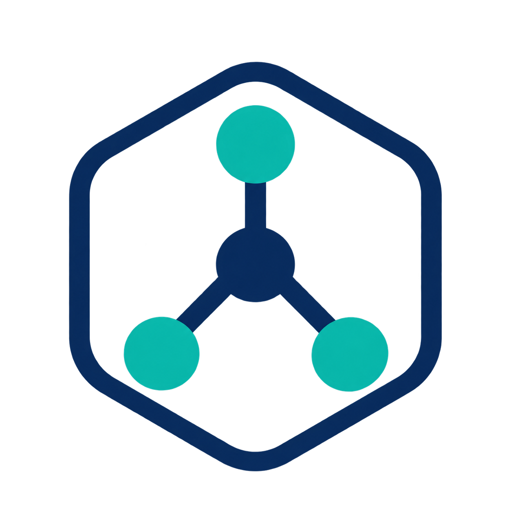

# AgentKit



[](https://github.com/getdownandcode/AgentKit/actions/workflows/ci.yml)
[](https://www.python.org/downloads/)
[](LICENSE)

AgentKit is a Python service for running tool-using AI agents. A client submits a goal, the agent asks a language model what to do, runs any requested tools, and returns a final answer. Runs and tool steps are recorded so they can be inspected later.

The runtime is implemented in this repository rather than delegated to an agent framework. It supports Google Gemini and OpenAI; the default Gemini model is `gemini-3.1-flash-lite`. Tests use a fake model client so the normal test suite does not need provider credentials.

## What happens during a run

1. FastAPI validates the request, checks the API key, and applies rate limiting.
2. The agent loads prior conversation messages for the optional session ID.
3. The selected model returns either an answer or one or more tool calls.
4. The tool registry validates each call against a generated Pydantic schema and runs it with timeout and output-size limits.
5. The agent sends tool results back to the model and repeats until it gets a final answer or reaches a guardrail.
6. Session history is stored in Redis; run records and step traces are stored in PostgreSQL.

Run requests are synchronous: `POST /runs` returns after the agent finishes. The loop has maximum-step, run-timeout, tool-timeout, and repeated-call protections.

## Start the service

### Requirements

- Python 3.11 or later
- Docker with the Compose plugin
- An API key for the model provider you choose (Gemini by default, or OpenAI)

### Configure and start

```bash
git clone https://github.com/getdownandcode/AgentKit.git
cd AgentKit
cp .env.example .env
```

Edit `.env` before starting Compose. Replace the example values for:

- `POSTGRES_PASSWORD`
- `POSTGRES_READONLY_PASSWORD`
- `REDIS_PASSWORD`
- `API_KEYS`
- `GEMINI_API_KEY` or `OPENAI_API_KEY`, according to `LLM_PROVIDER`

Use distinct, randomly generated passwords and API keys. The Compose stack rejects missing or weak datastore passwords and an empty API key list. Keep `.env` private; it contains secrets. Compose binds PostgreSQL and Redis to localhost by default.

Start the application:

```bash
docker compose up --build -d
docker compose ps
```

Compose starts PostgreSQL and Redis, runs migrations and demo-data seeding, provisions the dedicated read-only SQL role, then starts the API on `http://localhost:8000`.

Check service health:

```bash
curl -sS http://localhost:8000/health
```

### Make your first request

Use one key from the comma-separated `API_KEYS` setting as the `X-API-Key` header:

```bash
export AGENTKIT_API_KEY='your-local-api-key'

curl -sS -X POST http://localhost:8000/runs \
  -H "X-API-Key: $AGENTKIT_API_KEY" \
  -H 'Content-Type: application/json' \
  -d '{"goal":"Calculate 19 percent tax on 250"}'
```

Copy the `run_id` from the response and set it below:

```bash
export RUN_ID='paste-run-id-from-response'

curl -sS -H "X-API-Key: $AGENTKIT_API_KEY" \
  "http://localhost:8000/runs/$RUN_ID"

curl -sS -H "X-API-Key: $AGENTKIT_API_KEY" \
  "http://localhost:8000/runs/$RUN_ID/trace"
```

You can inspect the interactive API schema at [http://localhost:8000/docs](http://localhost:8000/docs). `GET /health` is public; run and tool endpoints require authentication.

## Try the demo without services

To see the agent loop without Docker, a model API key, or external services, install the package and run the scripted offline demo:

```bash
python3 -m venv .venv
source .venv/bin/activate
python -m pip install -e '.[dev]'
python examples/demo.py --offline
```

The demo uses `FakeLLMClient` and in-memory stores. It is intended to show the flow, not to test a live model. The live demo options and configuration are described by `python examples/demo.py --help`.

## How the repository is organized

| Path | What belongs here |
| --- | --- |
| `agentkit/api/` | FastAPI app, routes, request/response schemas, authentication, rate limiting, and dependency wiring. |
| `agentkit/core/` | The ReAct run loop, run types and errors, logging context, and trace interfaces. |
| `agentkit/llm/` | The provider-neutral LLM interface, Gemini and OpenAI adapters, factory, retry wrapper, and fake client. |
| `agentkit/tools/` | Tool models, schema generation, registry, executor, and built-in tools. |
| `agentkit/memory/` | Redis session history, PostgreSQL run storage, and the tiered store that combines them. |
| `agentkit/db/` | SQLAlchemy models and database/session setup. |
| `agentkit/config.py` | Pydantic settings loaded from environment variables and `.env`. |
| `migrations/` | Alembic schema migrations. |
| `scripts/` | Deployment credential checks, demo seeding, and read-only SQL role provisioning. |
| `examples/` | Runnable examples, including `demo.py`. |
| `tests/unit/` | Fast tests for isolated components; external LLMs are mocked. |
| `tests/integration/` | API and workflow tests using local test doubles and SQLite. |
| `tests/real/` | Opt-in tests against live PostgreSQL and Redis. |
| `docs/` | Architecture, deployment, specification, design decisions, audit notes, and progress log. |

The API assembles the provider, persistence, trace, and tool-registry dependencies and passes them to the agent. This keeps HTTP handling and provider-specific SDK details outside the run loop.

## Built-in tools

The standard API registry includes these tools:

- `calculator` evaluates arithmetic through a restricted AST evaluator.
- `read_file` reads files under the configured sandbox directory and blocks traversal and symlink escapes.
- `http_fetch` fetches HTTP(S) resources while blocking private, loopback, link-local, and metadata addresses.
- `sql_readonly` runs a single read-only query using the dedicated PostgreSQL role configured by `DATABASE_READONLY_URL`. It fails closed when that role is not configured.
- `web_search` is included only when `SEARCH_API_KEY` is set.

Tool arguments are validated against JSON Schema derived from Python function annotations. Synchronous tools run outside the event loop; tool results and errors are returned in a structured form.

## API at a glance

| Method and path | Purpose | Authentication |
| --- | --- | --- |
| `GET /health` | Liveness and database/Redis connectivity status. | No |
| `GET /tools` | List registered tools and their input schemas. | `X-API-Key` |
| `POST /runs` | Execute a goal; accepts `goal` and optional `session_id`. | `X-API-Key` |
| `GET /runs/{run_id}` | Read run status, answer, and token totals. | `X-API-Key` |
| `GET /runs/{run_id}/trace` | Read ordered tool steps and their results. | `X-API-Key` |

All run and tool endpoints are rate limited. The service does not currently expose background runs, cancellation, streaming responses, or a run-list endpoint. See the generated OpenAPI page for request and response details.

## Configuration

`.env.example` lists the supported environment variables. The main settings are:

| Setting | Purpose |
| --- | --- |
| `LLM_PROVIDER`, `LLM_MODEL` | Select `gemini` or `openai` and the model name. |
| `GEMINI_API_KEY`, `OPENAI_API_KEY` | Provider credentials. Set the key for the selected provider. |
| `API_KEYS` | Required comma-separated client keys for protected endpoints. |
| `POSTGRES_*`, `POSTGRES_READONLY_*` | PostgreSQL connection components and the separate read-only tool role. |
| `REDIS_URL`, `REDIS_PASSWORD` | Redis session and rate-limit storage. |
| `MAX_STEPS`, `RUN_TIMEOUT_S`, `TOOL_TIMEOUT_S` | Agent execution limits. |
| `SESSION_TTL_S`, `SESSION_MAX_MESSAGES` | Session-history expiry and size bound. |
| `RETRY_AFTER_FALLBACK_S` | Fallback wait in seconds when a provider rate-limit response has no valid retry header. |
| `SEARCH_API_KEY` | Enables the optional `web_search` tool. |
| `FILE_TOOL_BASE_DIR` | Root directory available to `read_file`. |

Settings can also be overridden through environment variables. In Compose, the datastore hostnames are set to the service names; `localhost` in the host `.env` file is for host-run commands and does not leak into the containers.

For production deployment, credential handling, backups, and network setup, use the [deployment guide](docs/DEPLOY.md).

## Add a tool

Create a typed function and register it with a `ToolRegistry`:

```python
from agentkit.tools.registry import ToolRegistry, tool

registry = ToolRegistry()


@tool(registry=registry)
def add_numbers(left: int, right: int) -> int:
    """Add two integers."""
    return left + right


schema = registry.schemas()[0]
schema.name, schema.parameters
```

The decorator derives the argument schema from the function signature. The registry can then be passed to an `Agent` or injected into an application. The executor wraps tool output or a handled tool failure in a structured `ToolResult`.

## Run checks

The default test suite is hermetic and does not need PostgreSQL, Redis, or real LLM credentials:

```bash
pytest
ruff check .
ruff format --check .
mypy agentkit tests
```

Tests under `tests/real/` are opt-in. They use real PostgreSQL and Redis and can clear run/step rows and test-session keys, so use a dedicated test database:

```bash
docker compose up -d postgres redis
AGENTKIT_REAL_INFRA=1 pytest -m real_infra tests/real
```

For design details, see [Architecture](docs/ARCHITECTURE.md), [Decisions](docs/DECISIONS.md), [Specification](docs/SPEC.md), and [Deployment](docs/DEPLOY.md).

## License

AgentKit is licensed under the MIT License. See [LICENSE](LICENSE).
